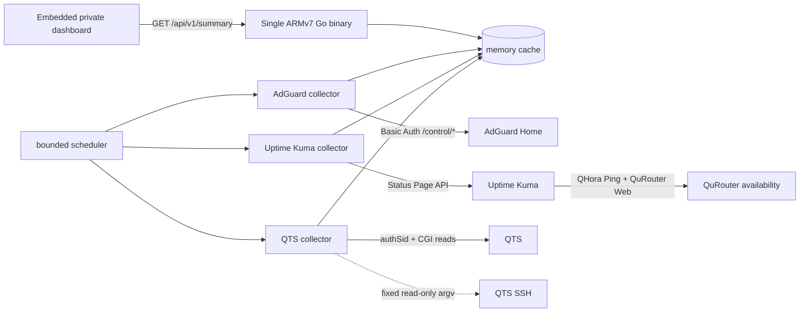

# AdGuard Home QNAP Extension

針對 TS-431K／ARMv7 設計的輕量私人監控網頁。單一 Go 程式內嵌前端與唯讀 API，集中顯示 **AdGuard Home、Uptime Kuma、QTS NAS 與 QuRouter** 狀態；瀏覽器不直接持有任何管理密碼。

> GitHub repository 名稱沿用既有的 `Extention` 拼字；專案與文件內一律稱為 **Extension**。

## 原始設計來源與實作狀態

這份設計是在 2026-09-16 評估 TS-431K 後提出的。當時希望安裝 Homepage，將 AdGuard Home、Uptime Kuma、QTS 與 QuRouter 集中到私人首頁；但 Homepage 已停止提供 32-bit ARMv7 映像，而 NAS 只有約 1 GB RAM、當時可用記憶體約 285 MB、Swap 已有明顯使用，因此改設計成：

- 單一 ARMv7 Go binary。
- 內嵌 HTML／CSS／JavaScript，不啟動 Node.js 或 Chromium。
- 最多使用約 48 MB RAM，目標常態為 10–30 MB。
- 所有來源每 60 秒最多更新一次，瀏覽器只讀 cache。
- 不使用資料庫、不掛載 Docker socket。
- 只綁定 NAS 的 Tailscale interface，避免暴露到 LAN／公網。

後續實際選擇先用既有 Uptime Kuma Status Page 完成「網路／NAS／服務」三組可用性監測，因此完整自製 Dashboard **當時停在已評估、未部署的設計階段**。本 repository 是將該原始網頁擴充設計正式固化，不把它誤寫成已在 NAS 上運行的成品。詳見 [設計沿革](docs/HISTORY.md)。

## 為什麼需要這個 Extension

家用或小型辦公室的 QNAP NAS 往往同時執行 DNS 過濾、Container Station、Tailscale、檔案服務與儲存管理。若每個 Dashboard widget 都獨立登入設備、查詢 SMART、掃描 Container 或重新統計 DNS query log，會造成幾個實際問題：

- 重複登入與重複輪詢會增加 QTS CGI、QuRouter control plane 及 NAS CPU 的負擔。
- SMART、RAID、query log 等資料更新速度不同；全部用數秒級輪詢只會製造無效 I/O。
- 瀏覽器直接串接多個管理介面會遇到 CORS、TLS、自簽憑證與 credential 暴露問題。
- QuRouter 登入可能碰到既有管理 session；強制登入可能中斷正在操作路由器的人。
- 任一設備逾時若沒有隔離，容易拖慢整個 AdGuard Home 頁面。

因此本設計不在 AdGuard Home 主程序內加入常駐重型 collector，也不把四套來源每次頁面刷新都查一遍。單一 Go 程式只在背景依資料成本輪詢一次，前端永遠讀取記憶體中的最新快照。

「AdGuard Home Extension」指的是與 AdGuard 管理入口並列的私人網頁擴充，不是修改或 fork AdGuard Home 原始碼。這樣 AdGuard Home 升級時不必重新套 patch。

## 系統邊界

### AdGuard Home

負責 DNS 服務本身的狀態，例如 protection、DNS bind address、版本、查詢量、封鎖量與上游健康。Extension 使用 AdGuard Home `/control/*` API，不解析其資料庫或 query log 檔案。

### QTS（NAS）

負責 NAS 系統、磁碟、Volume、RAID、Tailscale QPKG 與 Container Station 狀態。優先使用窄化的 QTS CGI 唯讀 API；只有 CGI 無法取得的資料才使用固定 allowlist 的 SSH probe。QTS 的「未知」不會被顯示為「健康」。

### Uptime Kuma

負責現有 monitor 的 UP／DOWN、延遲、最近 heartbeat 與 Status Page 分組。第一版優先重用 Kuma 已經完成的探測，不在 Extension 內重複對同一服務做 Ping／HTTP／DNS 檢查。

### QuRouter（路由器）

第一版只顯示由 Uptime Kuma 提供的 QHora Ping 與 QuRouter Web 可用性，並提供管理頁入口；不登入 QuRouter，也不輪詢 clients、events、WAN 或 ports。這是原始低資源設計刻意設定的界線。未來若啟用深度資訊，QuRouter 必須使用獨立 Bearer token 流程，而且遇到既有管理 session 時不得強制搶占。

## 架構



Bridge 的核心不是「更頻繁地抓資料」，而是把多個 UI consumer 合併成一組 bounded collectors：

1. 每個來源只有一個 in-flight request，避免 refresh 疊加。
2. 依成本設定不同 TTL，而不是共同使用最短週期。
3. 使用 jitter 避免所有探測在整分鐘同時啟動。
4. timeout、response-size limit、backoff 與 circuit breaker 分來源計算。
5. API 只傳正規化摘要，不把大型原始 XML、event log 或 query log 重複送到瀏覽器。
6. 前端頁面關閉後不會增加 collector 數量；多個瀏覽器也共用同一份快照。

原始第一版以 60 秒為共同上限；實作時可在不增加常駐 worker 的前提下，對昂貴資料採更長 TTL：

| 資料 | 建議 TTL | 原因 |
|---|---:|---|
| AdGuard Home status | 15 秒 | 輕量且使用者常需要即時確認 DNS 狀態 |
| AdGuard Home stats | 30 秒 | 統計不需要逐秒刷新 |
| Uptime Kuma heartbeat | 60 秒 | 重用現有 monitor，避免重複探測 |
| QTS CPU／記憶體／溫度 | 30 秒 | 保留操作感，同時限制 CGI 負擔 |
| QTS Storage／SMART summary | 5 分鐘 | 狀態變動慢，且可能觸發較多 I/O |
| `/proc/mdstat` | 60 秒；重建時 15 秒 | 平時低頻，偵測到 recovery/resync 才暫時加快 |
| QPKG metadata | 60 秒 | `Enable/Status` 不等同 runtime health |
| QuRouter | 不直接輪詢 | 第一版使用 Kuma 的 Ping／Web heartbeat |

完整設計見 [架構文件](docs/ARCHITECTURE.md)。

## API 如何串接

前端只呼叫同源的 Bridge：

```http
GET /extension/api/v1/summary
GET /extension/api/v1/sources/adguard
GET /extension/api/v1/sources/uptime_kuma
GET /extension/api/v1/sources/qts
```

Bridge 對上游的串接分開處理：

- **AdGuard Home**：以 Basic Auth 呼叫 `/control/status` 與 `/control/stats`。密碼只存在 bridge 的 secret store。
- **QTS**：呼叫 `/cgi-bin/authLogin.cgi` 取得短期 `authSid`，再讀取 `manaRequest.cgi`、`disk_manage.cgi`、`qsmart.cgi`。SID 不回傳前端；必要的 RAID／QPKG 資訊經固定 SSH argv 取得。
- **Uptime Kuma**：讀取 Status Page config／heartbeat API，取得 QHora Ping、QuRouter Web、QTS、AdGuard DNS／Web 等既有 monitor 結果。
- **QuRouter**：第一版不直接登入，只呈現 Kuma 的可用性結果與可點擊入口。深度 QuRouter API 串接是選用的未來擴充，且與 QTS 認證完全分離。

每個來源回應都包含：

```json
{
  "status": "ok | stale | unavailable | busy_active_session | indeterminate",
  "observed_at": "2026-11-04T00:00:00Z",
  "age_seconds": 12,
  "data": {},
  "limitations": []
}
```

`stale` 表示 bridge 正在使用成功取得的舊快照；`indeterminate` 表示資料不足，不能宣告健康。完整欄位與上游 endpoint 對照見 [API 文件](docs/API.md)。

## 實作方式

原始設計以獨立 Go container／QPKG 執行，靜態頁面由同一個 binary 提供；可由 AdGuard Home 前方的 reverse proxy 掛載 `/extension/`：

```text
/control/*               -> AdGuard Home
/extension/*             -> QNAP Monitor Bridge
```

這樣不需要 fork AdGuard Home，也不必在每次升級後重新套 patch。前端是一組靜態資產；Bridge 可使用 Go 單一 binary 或其他低開銷 runtime。部署設定請遵守以下原則：

- secrets 使用 QTS secret store、root-readable file 或 container secret，不寫進前端與 Git。
- QTS 與 QuRouter 使用不同的最小權限帳號。
- 只允許固定 endpoint／action，不提供通用 URL proxy、shell 或任意 package name。
- Bridge 預設只 listen loopback 或私有 container network，由既有 TLS reverse proxy 對外。
- 手動 refresh 仍受 per-source cooldown 限制，不能繞過 TTL 形成 DoS。

設定範例在 [`config.example.yaml`](config.example.yaml)，API contract 在 [`api/openapi.yaml`](api/openapi.yaml)。

## QTS 與 QuRouter 的差異摘要

| 項目 | QTS | QuRouter |
|---|---|---|
| 管理對象 | NAS、Storage、QPKG | 第一版僅 QHora Ping／QuRouter Web 可用性 |
| 認證 | QTS login + `authSid`；可能有 2FA | 第一版無登入，由 Kuma 代為監測 |
| Session 策略 | 短期重用，過期才重新登入 | 深度擴充才使用短期 Bearer token，且不得搶占既有 session |
| 深度 fallback | 固定 allowlist SSH probe | 無任意 shell fallback |
| 健康語義 | healthy / unhealthy / indeterminate | Kuma UP／DOWN／pending；深度 API 另行定義 |
| 主要風險 | Storage 欄位因韌體而異、SMART 深度不足 | 本地 monitor 無法在整條家中網路斷線時即時送出外部通知 |

## 安全與非目標

本專案是唯讀 Monitor，不會：

- 重建 RAID、修復 SMART 或寫入磁碟設定。
- 重啟 Tailscale、Container Station、AdGuard Home 或 QuRouter。
- 修改 DNS、DHCP、WAN、防火牆或 port 設定。
- 強制登出正在使用 QuRouter 管理介面的人。
- 將上游管理憑證、SID 或 token 送到瀏覽器。

## 專案狀態

目前 repository 固化的是先前評估完成但未部署的網頁擴充設計、API 邊界與低資源策略，作為後續實作成獨立 ARMv7 Go binary／QPKG 的契約。硬體或韌體新增 parser 前，應先加入已遮蔽的真實 fixture，而不是猜測欄位語義。

## License

[MIT](LICENSE)
